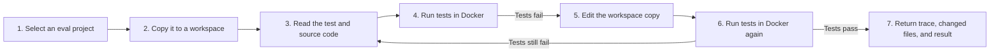

<h1 align="center">Build Your Own Python Repair Agent</h1>

<p align="center">
  
</p>

> **Before the lab:** complete the [Pre-lab environment check](docs/pre-lab-setup.md). Allow 45 to 60 minutes, plus a local-model download if you choose Ollama. It verifies the environment, model route, GitHub, and Langfuse connections before the activity begins.

## A guided, from-scratch activity

In this activity, you will build a small Python repair agent with a vibe-coding assistant such as Codex, Claude Code, or Cursor. The agent receives one buggy Python project and its tests. It must inspect the project, reproduce the failure by testing it, make a focused edit, and verify the repair in a Docker sandbox.

The final output is a visible action trace, a disposable repaired copy of the project, and the final test result. You are not given agent source code to complete. You will create the folders, files, tests, and implementation yourself. Your coding assistant may write code, but you are responsible for directing it, reviewing its changes, and running every checkpoint.

The required path, Tasks 0 through 6 and Task 8, is designed for a
two-and-a-half-hour lab. Task 7 is an optional live-model extension.

## Objective

Build a repair agent that:

- works only on one instructor-provided project selected from `evals/`;
- reproduces a failing test before it edits code;
- runs project code only inside Docker;
- accepts only a small, explicit set of model actions;
- stops when tests pass, the model response is invalid, or its decision budget ends; and
- can run from a terminal and a small web interface.

## Repair workflow at a glance

The agent works on a copy, never directly on `evals/`. The model proposes one action at a time; the surrounding Python program supplies the case context, limits the available actions, records the observations, and decides when to stop.



Follow this evidence order:

1. 🟦 **Inspect local code.** Read the relevant test and source files in the copied workspace.
2. 🟨 **Reproduce the bug.** Run a sandboxed test and observe a failing result before editing.
3. 🟧 **Make one focused edit.** Change only the copied workspace file needed to address the observed failure.
4. 🟩 **Verify the repair.** Run a later sandboxed test and accept the repair only if it passes.

**Sandboxed test** means `pytest` runs inside a short-lived Docker container with networking disabled. It receives only the disposable workspace copy, not the original `evals/` project or the rest of the host computer.

If the model sends an invalid action or the decision budget ends, the agent stops and reports the failure instead of guessing.

## Before you begin

Set up these required tools before class:

- A GitHub account and [Git](https://git-scm.com/downloads/). You need permission to fork the course repository and push to your own fork.
- [Python 3.11 or newer](https://www.python.org/downloads/).
- Docker with Linux-container support. Install [Docker Desktop for macOS](https://docs.docker.com/desktop/setup/install/mac-install/), [Windows](https://docs.docker.com/desktop/setup/install/windows-install/), or [Linux](https://docs.docker.com/desktop/setup/install/linux/), unless your instructor has already provided a working Docker Engine. Start Docker before Task 2. Colima, Rancher Desktop and Podman also work, provided the repair workspace is created under your home directory as Task 2 requires.
- A code editor and one vibe-coding assistant, such as Codex, Claude Code, or Cursor.
- A browser and Internet connection for the initial fork, Python-package installation, and Docker image download.

Keep some free disk space for the Docker image. The pre-lab page asks you to
test a preferred local Ollama model or one cloud fallback before class; Task 7
is where you connect that prepared model route to the agent.

Check your local tools before class:

```bash
git --version
python3 --version       # macOS or Linux
docker info
```

In Windows PowerShell, use `py --version` instead of `python3 --version`.
`docker info` must print a **Server** section and exit successfully. If it does
not, start Docker Desktop or ask the instructor to help with the local Docker
installation before you begin Task 2.

## Command convention

Unless a task says otherwise, run its commands from the root of your cloned
repository with the virtual environment active. If you open a new terminal,
activate it again before running `python`:

**macOS or Linux**

```bash
source .venv/bin/activate
```

**Windows PowerShell**

```powershell
.\.venv\Scripts\Activate.ps1
```

The **host computer** in this guide means your normal computer outside Docker.
The host starts the Docker container; evaluation-project Python runs only
inside that container.

You do **not** need Ollama, a large local model, a cloud-model account, or an API key for the required build and scripted checkpoints. Ollama is needed only for the optional live-model task.

## Optional integrations

`pip install -r requirements.txt` installs the required Python libraries,
including `pytest` and Gradio. Do not install those separately. It also
includes the OpenAI, Google, and Langfuse libraries so optional extensions can
be added without a second dependency setup.

The required Tasks 0 through 8 build `ScriptedClient` and, optionally,
`OllamaClient`. They do not require any cloud account or API key. Tasks 9 and
10 are separate opt-in extensions for bounded GitHub evidence and Langfuse
Cloud trajectory recording.

| Optional integration | When to use it | Setup |
| --- | --- | --- |
| Ollama | Optional Task 7 live model run | Install from [Ollama Download](https://ollama.com/download), then download an installed model with `ollama pull ...`. |
| GitHub code search | Optional Task 9 research extension | Create a short-lived, least-privilege token only if you complete [Task 9](tasks/09-github-research.md). The adapter calls GitHub's code-search API only. |
| Langfuse Cloud | Optional Task 10 observability extension | Create a Cloud project and API keys only if you complete [Task 10](tasks/10-langfuse-observability.md). |
| OpenAI or Google Vertex AI | Only if the instructor assigns a later extension | Follow the instructor's extension instructions. They are not part of this activity. |

Keep credentials out of the repository. These additions do not change the sandbox rule: the model client, optional research adapter, and observability code run on the host, while evaluation-project code runs only in Docker.

## Which branch to use

This activity is the `guided-from-scratch-activity` branch of the repository.
Task 0 creates your work branch from it. The default branch holds a different
version of the lab with the agent code already present; do not start from it.

## Current repository structure

The starter provides this guide, task handouts, `LICENSE`, `.gitignore`, the repair-agent icon, `requirements.txt`, and five fixed evaluation projects. It must not contain an implemented agent, hidden tests, model keys, or a completed Docker runner. Keep the working implementation in the instructor repository only.

The supplied evaluation projects are:

```text
evals/
├── arithmetic/          # small calculator bug
├── balanced_brackets/   # matching-type boundary bug
├── median/              # even-length boundary bug
├── multi_function/      # several text utility functions
└── unique_words/        # order-preservation bug
```

Do not edit files in `evals/`. Your repair agent must copy the selected project into a disposable workspace before it changes anything. The cases are teaching-sized fixtures, not HumanEval+ tasks. They follow the same useful evaluation habit: test ordinary behavior and a boundary or semantic case that a superficial repair can miss.

## How to use a vibe-coding assistant

Work in short tasks. For each task:

1. Give the assistant only the stated task and files.
2. Ask it to run the stated checkpoint.
3. Read the diff before accepting it.
4. Run the checkpoint yourself.
5. Commit the working task.

Use this prompt pattern whenever you ask for help:

```text
You are helping me build a teaching-sized Python repair agent.

Read the named files before changing anything. Work only on the files listed
in this task. Keep the repair decision code separate from Docker, model HTTP,
and Gradio code. Do not add a host shell, arbitrary project upload, Internet
search, API keys, or packages beyond those requested. An explicitly named
optional extension task is the only exception.

Task: <paste the task for this stage>

Verification: run <paste the command>. Report the actual result and every
file changed. Do not claim success if the command fails.
```

Treat the assistant's output as a proposed change, not proof that the code is correct.

## Safety rules

These rules are requirements, not suggestions.

- The agent may work only on a copied project selected from `evals/`.
- Never execute evaluation-project Python with host Python.
- The host may start Docker, but Docker alone runs `pytest` and generated project code.
- Do not give the model a free-form shell tool.
- Do not provide arbitrary file paths, public uploads, or Internet access in the required activity.
- Reject absolute paths and paths that escape the workspace, such as `../secret.txt`.
- Do not put model or service secrets in source files, commits, or traces.
- Require a failing sandboxed test result before allowing an edit.
- Keep a short public action summary, not private model reasoning.

## A map of the files you will build

Do not try to understand or implement this whole tree now. It is a map for the activity. Each task tells you which small group of files to create next and what to check before moving on. The small `__init__.py` files simply tell Python that a folder can be imported as a package.

```text
coding-agent-lab/
├── README.md                          # this guide
├── requirements.txt                   # supplied Python dependencies
├── tasks/                             # supplied task handouts
│   ├── 00-setup.md
│   ├── 01-core-vocabulary.md
│   ├── 02-sandbox-tools.md
│   ├── 03-prompts-and-clients.md
│   ├── 04-repair-loop.md
│   ├── 05-cli-repair.md
│   ├── 06-gradio-ui.md
│   ├── 07-live-ollama.md
│   ├── 08-final-demonstration.md
│   ├── 09-github-research.md        # optional extension
│   └── 10-langfuse-observability.md # optional extension
├── pytest.ini                         # you create this
├── main.py                            # you create this
├── bootstrap.py                       # you create this
├── core/                              # you create this folder
│   ├── __init__.py
│   ├── models.py
│   ├── ports.py
│   ├── prompts.py
│   ├── repair_agent.py
│   └── repair_service.py
├── adapters/                          # you create this folder
│   ├── __init__.py
│   ├── gradio_ui.py
│   ├── models/
│   │   ├── __init__.py
│   │   ├── ollama.py
│   │   └── scripted.py
│   ├── sandbox/
│       ├── __init__.py
│       ├── Dockerfile
│       ├── runner.py
│       └── repair_tools.py
│   ├── research/                    # optional Task 9 package
│   │   ├── __init__.py
│   │   └── github_research.py
│   └── observability/               # optional Task 10 package
│       ├── __init__.py
│       └── langfuse.py
├── evals/                             # supplied, never modified
│   ├── arithmetic/
│   ├── balanced_brackets/
│   ├── median/
│   ├── multi_function/
│   └── unique_words/
└── tests/                             # you create this folder
    ├── test_tools.py
    ├── test_agent.py
    ├── test_github_research.py        # optional Task 9
    └── test_langfuse_observability.py # optional Task 10
```

### What each file will do

| File | Concrete responsibility |
| --- | --- |
| `README.md` | Gives you the overview, workflow, safety rules, and task links. |
| `requirements.txt` | Installs the Python libraries used by the lab. It is supplied. |
| `tasks/*.md` | Gives the exact instructions, prompt, and checkpoint for one task. They are supplied. |
| `pytest.ini` | Restricts host `pytest` to your `tests/` folder, so host Python never runs files in `evals/`. |
| `main.py` | Accepts `repair` and `ui` commands, starts the selected workflow, and prints the visible trace. |
| `bootstrap.py` | Creates and connects the selected model client, Docker-backed tools, and repair service. Optional extensions are connected here only when enabled. |
| `core/__init__.py` | Marks `core/` as an importable package. |
| `core/models.py` | Defines small result objects, including test results, model actions, and the final repair result. |
| `core/ports.py` | Describes the small capabilities the repair agent needs: chat, file tools, tests, and optional research or trace recording. |
| `core/prompts.py` | Holds the system and user messages, JSON action rules, and tool-result formatting. |
| `core/repair_agent.py` | Runs the bounded repair loop: ask the model, validate one action, call one permitted tool, store the observation, and stop safely. |
| `core/repair_service.py` | Selects an allowed evaluation project, creates its disposable workspace, and returns the agent result. |

| File | Concrete responsibility |
| --- | --- |
| `adapters/__init__.py` | Marks `adapters/` as an importable package. |
| `adapters/gradio_ui.py` | Presents the existing repair service in a page with project selection, trace, changed code, test output, and a ZIP download. |
| `adapters/models/__init__.py` | Marks the model-adapter folder as importable. |
| `adapters/models/ollama.py` | Sends messages to local Ollama and returns the model's text response. |
| `adapters/models/scripted.py` | Returns predetermined model replies so your repair-loop tests are repeatable without an LLM. |
| `adapters/sandbox/__init__.py` | Marks the sandbox folder as importable. |
| `adapters/sandbox/Dockerfile` | Defines the small non-root Docker image that can run pytest. |
| `adapters/sandbox/runner.py` | Copies a chosen evaluation project and starts the restricted Docker test command against that copy. |
| `adapters/sandbox/repair_tools.py` | Implements safe `read_file`, `edit_file`, and `run_tests` operations inside the copied workspace. |
| `adapters/research/__init__.py` | Marks the optional research-adapter folder as importable. |
| `adapters/research/github_research.py` | Optional, bounded client for GitHub code-search evidence. It does not browse arbitrary URLs. |
| `adapters/observability/__init__.py` | Marks the optional observability-adapter folder as importable. |
| `adapters/observability/langfuse.py` | Optional Langfuse Cloud recorder for the public repair trajectory. |

| File or folder | Concrete responsibility |
| --- | --- |
| `evals/<case>/` | Supplied buggy source file and pytest file. The agent can read a copied case but must never modify the original. |
| `tests/test_tools.py` | Proves safe path handling, file edits, and test-runner delegation. |
| `tests/test_agent.py` | Proves the repair loop with `ScriptedClient`, including invalid JSON and stopping rules. |
| `tests/test_github_research.py` | Optional Task 9 checks the GitHub boundary with fake HTTP responses. |
| `tests/test_langfuse_observability.py` | Optional Task 10 checks trajectory recording with a fake Langfuse client. |

One practical rule will keep the project understandable: files in `core/` must not import files from `adapters/`. `bootstrap.py` is the one place that selects the real model, sandbox, and UI pieces and connects them to the repair service.

## Build tasks

Complete the tasks in this order. Task 7 is optional; Task 8 can use the scripted repair if a live model is unavailable.

1. [Task 0: Set up the repository and environment, 10 minutes](tasks/00-setup.md)
2. [Task 1: Define the agent's small vocabulary, 15 minutes](tasks/01-core-vocabulary.md)
3. [Task 2: Build the safe workspace and tools, 25 minutes](tasks/02-sandbox-tools.md)
4. [Task 3: Prepare prompts and a test model, 15 minutes](tasks/03-prompts-and-clients.md)
5. [Task 4: Build the repair loop, 40 minutes](tasks/04-repair-loop.md)
6. [Task 5: Run a scripted repair from the terminal, 15 minutes](tasks/05-cli-repair.md)
7. [Task 6: Show a repair in a small web page, 20 minutes](tasks/06-gradio-ui.md)
8. [Task 7: Try a real local model with Ollama (optional), 15 minutes](tasks/07-live-ollama.md)
9. [Task 8: Prepare the final demonstration, 10 minutes](tasks/08-final-demonstration.md)

### Optional extensions after the required activity

These extensions are deliberately separate from the required lab. Do not begin
either one until the scripted repair and its checkpoints work.

10. [Task 9: Add bounded GitHub research (optional), 20 minutes](tasks/09-github-research.md)
11. [Task 10: Record a trajectory with Langfuse Cloud (optional), 20 minutes](tasks/10-langfuse-observability.md)
