# Task 0: Set up the repository and environment, 10 minutes

[Back to the activity overview](../README.md)

## Setup flow

```mermaid
flowchart LR
    fork["(1) Fork the course repository"] --> clone["(2) Clone your fork"]
    clone --> branch["(3) Create your work branch"]
    branch --> structure["(4) Create the initial folders\nand pytest.ini"]
    structure --> environment["(5) Create the Python environment\nand install dependencies"]
    environment --> check["(6) Run the setup checkpoint"]

    classDef gitBox fill:#f3e8ff,stroke:#9333ea,color:#581c87
    classDef setupBox fill:#dbeafe,stroke:#2563eb,color:#172554
    classDef environmentBox fill:#dcfce7,stroke:#16a34a,color:#14532d
    classDef checkBox fill:#e0f2fe,stroke:#0284c7,color:#0c4a6e

    class fork,clone,branch gitBox
    class structure setupBox
    class environment environmentBox
    class check checkBox
```



## 1. Create your working copy

Open the course repository on GitHub with the
`guided-from-scratch-activity` branch selected, then select **Fork**. If
GitHub offers **Copy the DEFAULT branch only**, leave it unchecked so your fork
contains this activity branch. GitHub creates a copy under your own account.
Then clone that branch and create a branch for your work. Replace
`YOUR-USERNAME` with your GitHub username.

```bash
git clone --branch guided-from-scratch-activity --single-branch https://github.com/YOUR-USERNAME/coding-agent-lab.git
cd coding-agent-lab
git switch -c build-repair-agent origin/guided-from-scratch-activity
```

This activity lives on the `guided-from-scratch-activity` branch, not on the
repository's default branch. The `git switch` command above starts your work
branch from it. If `ls` shows a `core/` or `adapters/` folder, or `tests/`
already contains files, you are on the wrong branch: run the `git switch`
command again.

Do not run `git init` before or after `git clone`: cloning already creates the
local Git repository and configures its `origin` remote. Confirm that you are
working from your fork and on your work branch:

```bash
git remote -v
git branch --show-current
ls
```

The expected branch name is `build-repair-agent`, and `ls` should list only
`LICENSE`, `README.md`, `docs`, `evals`, `requirements.txt`, and `tasks`.

### Set Git author information if needed

You will make a commit after this setup task. Git needs a name and email for
that commit. Check whether this computer already has them configured:

```bash
git config user.name
git config user.email
```

If either command does not print a value, set a repository-only identity. Use
your own name and email address:

```bash
git config --local user.name "Your Name"
git config --local user.email "you@example.com"
```

## 2. Create the initial file structure

The starter already provides `requirements.txt` with the Python libraries used
in this lab. Ask your coding assistant to create these folders and files, and
nothing else yet:

```text
core/__init__.py
adapters/__init__.py
adapters/models/__init__.py
adapters/sandbox/__init__.py
tests/.gitkeep
pytest.ini
```

The `__init__.py` files are empty; `tests/.gitkeep` is an empty file that lets
Git keep the otherwise empty `tests/` folder. Use Python 3.11 or newer.
`pytest.ini` must set `testpaths = tests` so that a host pytest command never
discovers or executes tests inside `evals/`.

```ini
[pytest]
testpaths = tests
```

## 3. Create the Python environment

**macOS or Linux**

```bash
python3 -m venv .venv
source .venv/bin/activate
python -m pip install --upgrade pip
python -m pip install -r requirements.txt
```

**Windows PowerShell**

```powershell
py -m venv .venv
.\.venv\Scripts\Activate.ps1
python -m pip install --upgrade pip
python -m pip install -r requirements.txt
```

If PowerShell blocks activation, run `Set-ExecutionPolicy -Scope Process -ExecutionPolicy Bypass` and activate the environment again.

## 4. Checkpoint

```bash
python --version
python -m pip check
git status --short
```

Expected outcome: `python --version` prints 3.11 or newer, `pip check` prints
`No broken requirements found.`, and `git status --short` lists only the new
folders and `pytest.ini`. Do not run `pytest` yet: there are no tests in
`tests/` and the supplied evaluation tests must run only in Docker. Commit the
file structure before starting Task 1.

## Where to go next

Open [Task 1: Define the core vocabulary](01-core-vocabulary.md).
