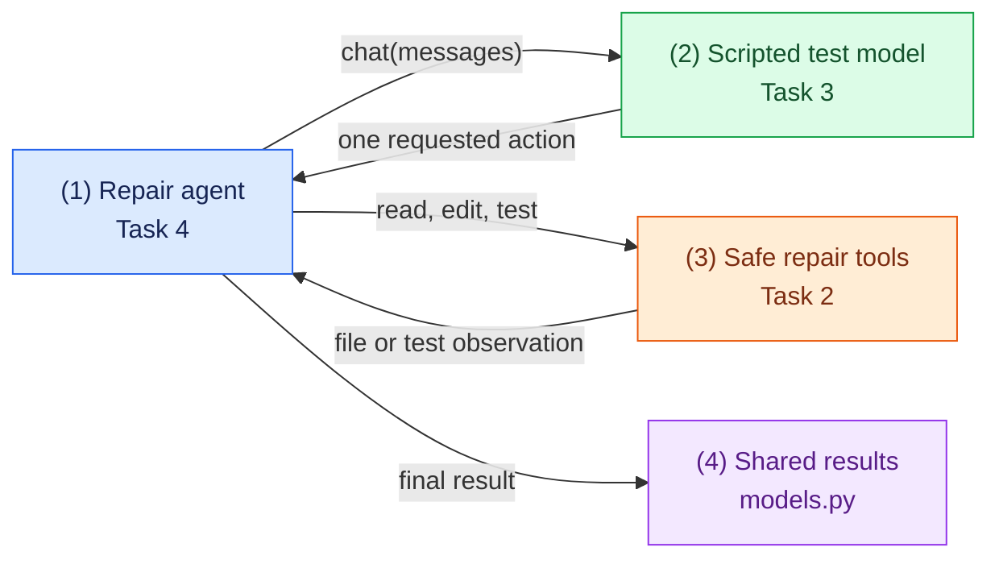

# Task 1: Define the agent's small vocabulary, 15 minutes

[Back to the activity overview](../README.md)

## Why these two files come first

You will build the repair loop in Task 4. That loop needs to talk to a model,
ask tools to read, edit, and test code, and return a result. Before building
those parts, give them a common vocabulary and a small set of promises.

### Flow of this task



`core/models.py` defines the structured information that moves through this
workflow. `core/ports.py` defines the small operations that the future repair
agent may ask another part of the program to perform. Neither file performs
an API call, starts Docker, or displays a web page.

| File | Why it exists | How it helps later |
| --- | --- | --- |
| `core/models.py` | Every part of the agent needs the same names and shapes for results. This avoids passing loose dictionaries with inconsistent keys. | Keeps repair information organized as it moves through the workflow. |
| `core/ports.py` | The repair loop should work with either a scripted client or Ollama, and with real tools or test doubles. | Lets the repair loop use outside help without knowing its implementation. |

## Prompt for your coding assistant

Copy this prompt into your coding assistant. Its purpose is to keep the first
change small: create only the shared vocabulary and contracts that later tasks
will use.

```text
Create core/models.py and core/ports.py only. Use @dataclass to define three
small named containers: TestResult(passed, output, returncode),
ModelAction(tool, arguments, optional public summary), and RepairResult
(passed, trace entries, changed files, workspace location, most recent test
result). In core/ports.py, use typing.Protocol to define a ChatClient with
chat(messages) -> str, RepairToolsPort with read_file, edit_file, and
run_tests, and an optional TraceRecorder with record(event, payload). The
name ends in Port because Task 2 creates a concrete class named RepairTools
that satisfies it. Use only the
standard library and core modules. Do not import adapters, Docker, Gradio, or
an HTTP client. Add concise docstrings. Do not call an LLM or repair a project.
```

### A term used in the prompt

A Python `Protocol` is a type-level promise: it describes methods an object
must provide without choosing its implementation. For example, the repair
agent needs an object with `chat(messages) -> str`; Task 3 provides the
scripted client, while optional Task 7 adds the Ollama client.

### A checkpoint note

Pytest may treat a class whose name begins with `Test` as a test class. Add
`__test__ = False` inside the required `TestResult` data class so importing it
in `tests/` does not produce a collection warning.

## Checkpoint

```bash
python -m compileall -q core
```

Expected outcome: the new `core/` package compiles. You now have the shared
names and contracts needed to build the concrete safe tools in Task 2.

## Where to go next

Open [Task 2: Build the sandbox tools](02-sandbox-tools.md).
