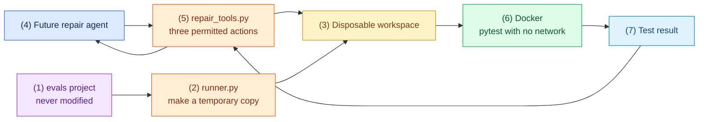

# Task 2: Build the safe workspace and tools, 25 minutes

[Back to the activity overview](../README.md)

## Why this task comes next

The repair agent will eventually ask to read a file, edit a file, or run tests.
Those requests must operate on a disposable copy, not on the supplied project
in `evals/` or on the host computer. This task creates that safety boundary.

### Flow of this task



The host program may start Docker, but only Docker may execute evaluation
project code or `pytest`. The model receives no shell, Internet, upload, or
arbitrary-path capability.

## Prompt for your coding assistant

Copy this prompt into your coding assistant. It defines the complete scope of
this task.

```text
Implement only adapters/sandbox/Dockerfile, adapters/sandbox/runner.py,
adapters/sandbox/repair_tools.py, and tests/test_tools.py. In the Dockerfile,
install Python and pytest and run as a non-root user. In runner.py, copy the
selected evals/<case> directory to a new disposable workspace folder created
under the user's home directory (for example ~/.cache/coding-agent-lab/),
never under the system temporary directory: Docker Desktop shares macOS's
/var/folders with its virtual machine, but Colima, Rancher Desktop and Podman
share only the home directory, and a mount of an unshared path is empty inside
the container. Then invoke a short-lived Docker container with networking
disabled to run pytest -q -p no:cacheprovider against that copy. Mount only
the copied workspace into the container, read-only. Return a structured test
result with passed, output, and returncode.

In repair_tools.py, implement a safe_path(workspace, requested_path) helper
that rejects absolute paths and resolved paths outside the workspace. Implement
only read_file(path), edit_file(path, content), and run_tests(). Read and write
UTF-8 files inside the workspace; record each changed relative path once; make
run_tests delegate to the Docker-backed runner. The host may invoke Docker but
must never execute fixture Python or pytest directly. Do not add a shell tool,
Internet access, arbitrary paths, or uploads.

Write focused pytest tests showing: a normal workspace file can be read;
absolute and ../ paths are rejected; an edit is saved and recorded once; and
run_tests delegates to the runner rather than launching host Python. Add
concise docstrings and do not change files outside this task.
```

### A safety term used in the prompt

**Path traversal** is an attempt to escape the workspace with a path such as
`../secret.txt` or an absolute path. `safe_path` must reject it before the
program reads or writes a file.

## Checkpoint

Before running this checkpoint, make sure `docker info` succeeds. If it does
not, Docker is not ready yet: start Docker Desktop or resolve the Docker setup
described in [Before you begin](../README.md#before-you-begin). Do not replace
the Docker command with host `pytest`.

```bash
python -m pytest -q tests/test_tools.py
docker build -t coding-agent-lab-runner adapters/sandbox
```

Expected outcome: your unit tests pass, and Docker builds the runner image.
The first build downloads the Python base image, which can take a few minutes
on a slow connection. Do not run an evaluation project with host Python to test
this task.

If you use Colima, Rancher Desktop or Podman instead of Docker Desktop, a
sandboxed test that reports `no tests ran` means the workspace folder is not
shared with the container's virtual machine; keep the workspace under your home
directory as the prompt requires.

## Where to go next

Open [Task 3: Prepare prompts and a test model](03-prompts-and-clients.md).
