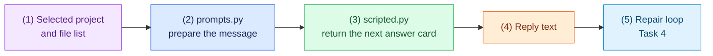

# Task 3: Prepare prompts and a test model, 15 minutes

[Back to the activity overview](../README.md)

## What this task gives the future agent

The repair loop in the next task needs to ask, “What should I do next?” It
will send a message containing the chosen project and allowed actions. This
task prepares that message and creates a small fake model for testing it.

`scripted.py` is not an AI model. Think of it as a stack of answer cards. You
place prepared answers in the stack. Each time the repair loop asks for the
next step, `scripted.py` gives back the next card. For example, the first card
can be `{"tool":"read_file","path":"test_calculator.py"}` and the second
can be `{"tool":"run_tests"}`. Because the answers are prepared, every test
run follows the same sequence.

### Flow of this task



You do not need Ollama, an account, a model download, or an Internet connection
for this task. The optional local Ollama connector comes later in Task 7.

## Prompt for your coding assistant

Copy this prompt into your coding assistant. It defines the complete scope of
this task.

```text
Implement only core/prompts.py and adapters/models/scripted.py.

In core/prompts.py, keep all text that will be sent to a model in small helper
functions: one system instruction, one request that includes the selected case
name and supplied relative file list, and one message for a tool result. The
system instruction must tell the model to inspect local code, reproduce a
failing test before editing, make a focused edit, and verify the repair with
tests. It must ask for one JSON object only, with no Markdown or prose. Include
these three allowed action examples in that instruction:
{"tool":"read_file","path":"test_calculator.py","summary":"Read the test"}
{"tool":"run_tests","summary":"Reproduce the failure"}
{"tool":"edit_file","path":"calculator.py","content":"..."}
The optional summary is a short label shown in the trace, not private reasoning.
Do not parse or execute a reply in this file; Task 4 does that.

In adapters/models/scripted.py, implement the `chat(messages) -> str`
interface from Task 1 as the answer-card model described in the task. It
accepts an ordered list of pre-written reply strings. Each chat call returns
the next string. Raise a clear error if no reply remains. It must not call a
model, Docker, or the Internet. Use concise docstrings. Do not add Docker,
Gradio, a shell tool, or new Python packages.
```

### A term used in the prompt

**JSON** is a compact text format for labelled information. For example,
`{"tool":"run_tests"}` tells the repair loop exactly which permitted action
the model wants next. In Task 4, the loop will check that this text is valid
before it does anything.

## Checkpoint

```bash
python -m compileall -q core adapters/models
```

Expected outcome: the message helpers and scripted test model compile. No
model download or live model call is required.

## Where to go next

Open [Task 4: Build the repair loop](04-repair-loop.md).
