# Task 4: Build the repair loop, 40 minutes

[Back to the activity overview](../README.md)

## What this task gives the agent

This is the central task. `RepairAgent` is the traffic controller around the
model. The model may suggest a next step, but the Python code decides whether
that step is valid, whether it is allowed yet, and when the repair is finished.
The model never receives direct access to files, Docker, or a shell.

Each turn of the loop is deliberately small: ask for one action, check it, run
at most one permitted tool, then show the result to the model before asking
again.

### Flow of this task

```mermaid
flowchart LR
    start["(1) Project context"] --> ask["(2) Ask for one\nnext action"]
    ask --> reply["(3) Model reply text"]
    reply --> check["(4) RepairAgent checks\nformat and policy"]
    check -->|"valid"| tool["(5) Run one safe tool"]
    tool --> observation["(6) Tool observation"]
    observation --> history["(7) Add result to\nconversation history"]
    history --> decision{"(8) Tests pass?\nor budget used?"}
    decision -->|"continue"| ask
    decision -->|"pass or stop"| result["(9) RepairResult\ntrace and final test result"]
    check -->|"invalid reply"| result

    classDef startBox fill:#f3e8ff,stroke:#9333ea,color:#581c87
    classDef agentBox fill:#dbeafe,stroke:#2563eb,color:#172554
    classDef modelBox fill:#dcfce7,stroke:#16a34a,color:#14532d
    classDef toolBox fill:#ffedd5,stroke:#ea580c,color:#7c2d12
    classDef resultBox fill:#e0f2fe,stroke:#0284c7,color:#0c4a6e

    class start startBox
    class ask,check,history,decision agentBox
    class reply modelBox
    class tool,observation toolBox
    class result resultBox
```



The required evidence order is: read local code, reproduce a failing sandboxed
test, make a focused edit, then verify with a later sandboxed test. An edit is
not allowed before the first two pieces of evidence exist.

## Prompt for your coding assistant

Copy this prompt into your coding assistant. It defines the complete scope of
this task.

```text
Implement only core/repair_agent.py and tests/test_agent.py. Use the models,
prompt helpers, and chat/tools interfaces created in earlier tasks. Do not
import adapters, Docker, Ollama, Gradio, or a shell tool into core/repair_agent.py.

Create RepairAgent as the traffic controller for a bounded repair loop. Start
the conversation with the system instruction and case request from
core/prompts.py. A decision is one call to client.chat(messages). For each
decision, parse the raw reply as exactly one JSON object. Reject prose,
Markdown fences, arrays, malformed JSON, duplicate keys, unknown tools,
missing fields, and fields that are not allowed for that tool. Convert an
accepted reply to ModelAction. Only read_file(path), run_tests(), and
edit_file(path, content) are permitted.

Before an edit, require one successful read_file observation and one failing
run_tests observation from this repair attempt. Reject an edit that arrives
too early; do not call the edit tool. Instead, add a visible policy-error
observation to the conversation, so the model can choose another step. After
every accepted model reply, add it to conversation history. After every tool
call, add a user message containing the tool observation, so the model can
choose the next step. Keep a visible trace with repair_started, model_response,
tool_result, and repair_finished. The trace may include the action's short
public summary, but never requests private reasoning.

Return a RepairResult in every outcome, including when client.chat raises an
error (for example, a ScriptedClient that has run out of replies) or a tool
raises an error (a missing file, or a path that escapes the workspace): record
a client error as a failed outcome, and turn a tool error into a visible error
observation so the model can choose another step. Return success only when a
run_tests result passes after an edit that followed a failing run_tests; a
run_tests result that passes before any edit means there is no reproducible
bug, so finish with a failed outcome that says so. Return failure when a reply
is invalid or when an eight-decision budget is reached. Use ScriptedClient and
fake tools in tests; do not run Docker or an evaluation project with host
Python. Test these cases: a successful read → failing test → edit → passing
test sequence; invalid JSON that calls no tool; an edit rejected before a
failing test; budget exhaustion; a passing baseline that is not reported as a
repair; and a client error that still returns a RepairResult.
```

### A term used in the prompt

A **decision budget** is the maximum number of times the agent may ask for a
next action. It prevents an agent from continuing forever when it cannot fix a
project. For this activity, use eight decisions.

## Checkpoint

```bash
python -m pytest -q tests/test_agent.py
python -m pytest -q
```

Expected outcome: all tests you wrote pass. They use `ScriptedClient` and fake
tools, so they do not contact Ollama or execute evaluation-project code on the
host.

## Where to go next

Open [Task 5: Run a scripted repair from the terminal](05-cli-repair.md).
