# Task 5: Run a scripted repair from the terminal, 15 minutes

[Back to the activity overview](../README.md)

## What this task gives the agent

The repair loop can now make decisions, but it needs a simple way for a person
to start a repair. This task adds one terminal command. The command chooses an
allowed evaluation project, creates its disposable copy, runs the existing
agent, and prints what happened.

### Flow of this task

```mermaid
flowchart LR
    command["(1) Terminal command\nrepair evals/arithmetic"] --> main["(2) main.py\nread command options\nand print results"]
    main --> bootstrap["(3) bootstrap.py\nconnect existing pieces"]
    bootstrap --> service["(4) repair_service.py\nselect and copy one eval"]
    service --> agent["(5) RepairAgent\nfrom Task 4"]
    agent --> output["(6) Visible trace\nchanged files\ntest result"]

    classDef commandBox fill:#f3e8ff,stroke:#9333ea,color:#581c87
    classDef commandLineBox fill:#dbeafe,stroke:#2563eb,color:#172554
    classDef serviceBox fill:#dcfce7,stroke:#16a34a,color:#14532d
    classDef agentBox fill:#ffedd5,stroke:#ea580c,color:#7c2d12
    classDef outputBox fill:#e0f2fe,stroke:#0284c7,color:#0c4a6e

    class command commandBox
    class main,bootstrap commandLineBox
    class service serviceBox
    class agent agentBox
    class output outputBox
```



`bootstrap.py` is only the assembly point. It creates and connects the pieces
you already built; it does not decide how to repair code. `repair_service.py`
accepts only the supplied projects under `evals/`, asks the workspace runner
to make a copy, and gives the agent that copy. It must never change the
original evaluation project.

## Prompt for your coding assistant

Copy this prompt into your coding assistant. It defines the complete scope of
this task.

```text
Implement only core/repair_service.py, bootstrap.py, and main.py. Reuse the
existing RepairAgent, ScriptedClient, safe tools, and workspace runner. Do not
change files in evals/ and do not execute an evaluation project with host
Python.

In core/repair_service.py, accept one selected project under evals/. Reject an
absolute path, a path outside evals/, or an unknown project. Ask the existing
runner to copy the selected project into a disposable workspace. Build the
relative file list from that copy, run RepairAgent against it, and return the
RepairResult. Do not put command-line parsing or Docker commands in this file.

In bootstrap.py, create the real runner-backed repair tools, the selected chat
client, RepairAgent, and RepairService, then connect them. This is the only
file that imports both core/ and adapters/. For --provider scripted, create a
ScriptedClient with an ordered answer-card sequence for each of the five
supplied cases: arithmetic, balanced_brackets, median, multi_function, and
unique_words. The terminal checkpoint below starts with arithmetic and
multi_function; Task 6 needs the same provider to support every dropdown
choice. Read each fixture and prepare a valid read → failing test → edit →
passing test sequence. Keep the sequences separate from the repair loop.

In main.py, provide this command:
python main.py repair evals/arithmetic --provider scripted
Accept the selected eval path and --provider. For the scripted provider, print
each visible trace event as it occurs, then print changed relative files and
the final sandboxed test result. Return a non-zero exit status if the repair
fails. Do not add a web interface, arbitrary project upload, a shell tool, or
Internet access.
```

### A term used in the prompt

The **assembly point** is the one place where an application connects its
parts. Here, `bootstrap.py` connects the repair rules in `core/` to concrete
tools in `adapters/`. Keeping this wiring in one file stops the repair loop
from depending directly on the command line, Docker, or a model provider.

## Checkpoint

This checkpoint runs the real Docker sandbox. Before it, confirm that Docker is
running and that the Task 2 image exists:

```bash
docker info
docker image ls coding-agent-lab-runner
```

Then run the scripted repairs:

```bash
python main.py repair evals/arithmetic --provider scripted
python main.py repair evals/multi_function --provider scripted
```

Expected outcome: each command prints a trace showing local inspection, a
failing test, an edit, and a passing test. It then prints the changed files and
final test result. The original files under `evals/` remain unchanged.

If Docker is not running, the first `run_tests` observation reports a runner
error instead of a failing test, the scripted edit still happens, and the
repair ends as a failure. That is the harness working as designed: start
Docker and run the command again.

## Where to go next

Open [Task 6: Show a repair in a small web page](06-gradio-ui.md).
