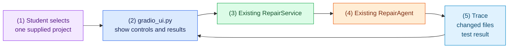

# Task 6: Show a repair in a small web page, 20 minutes

[Back to the activity overview](../README.md)

## What this task gives the agent

The web page does not repair code itself. It is another way for a person to
start the same repair service used by the terminal command. A student selects
one supplied project, starts the repair, and sees the trace and result that
already come from the existing service.

### Flow of this task



The page offers only the five supplied `evals/` projects. There is no upload
box and no free-form path field, so a browser user cannot give the agent an
arbitrary project. The page must not build prompts, call Docker, or make
repair-policy decisions.

## Prompt for your coding assistant

Copy this prompt into your coding assistant. It defines the complete scope of
this task.

```text
Implement adapters/gradio_ui.py and make only the small change needed in
main.py to provide `python main.py ui`. Reuse the existing RepairService; the
UI must not create a second repair loop or call Docker directly.

In adapters/gradio_ui.py, provide a create_demo function that builds a Gradio
page. It must offer a dropdown containing exactly arithmetic,
balanced_brackets, median, multi_function, and unique_words. When the user
starts a repair, call the existing service for that selected case. Display the
visible trace, changed relative files with their changed text, and final test
output. Also provide a ZIP download of the repaired disposable workspace.

Use the scripted provider by default so the page works without a model
download. Do not add a file-upload component, a free-form project path, prompt
creation, Docker calls, a shell tool, Internet access, or new Python packages.
Keep repair decisions in core/ and add concise docstrings.
```

The default scripted service needs an answer-card sequence for every one of
the five dropdown choices. If a selection reports that it has no scripted
repair, return to Task 5 and add the missing sequence before continuing.

### A term used in the prompt

A **presentation layer** receives input and displays output. In this task,
Gradio is the presentation layer: it shows the repair service's result but
does not decide what the model may do.

## Checkpoint

```bash
python -c "from adapters.gradio_ui import create_demo; create_demo(); print('Gradio UI built')"
python main.py ui
```

Expected outcome: the first command builds the interface. The second starts a
local web server and prints an address to open in a browser. Select
`arithmetic` first, then confirm that every listed case can complete a
scripted repair and shows the same kind of trace and result as the terminal
command.

## Where to go next

Choose one of the following paths:

- Continue to [Task 7: Try a real local model with Ollama](07-live-ollama.md)
  if you want to try a local model.
- Continue to [Task 8: Prepare the final demonstration](08-final-demonstration.md)
  if you are using the scripted provider only.
