# Task 7: Try a real local model with Ollama (optional), 15 minutes

[Back to the activity overview](../README.md)

## What changes and what stays the same

Complete this task only after the scripted terminal repair works. Until now,
`scripted.py` supplied prepared answer cards. Here, `ollama.py` obtains the
reply text from a real local model instead. Everything else stays the same:
the repair loop still validates every reply, the model still has only the three
permitted actions, and tests still run inside Docker.

### Flow of this task

```mermaid
flowchart LR
    prompts["(1) Existing prompts"] --> ollamaClient["(2) ollama.py\nOllamaClient"]
    ollamaClient --> ollama["(3) Ollama on your computer\nlocal model"]
    ollama --> reply["(4) Reply text"]
    reply --> agent["(5) Existing RepairAgent\nchecks every reply"]
    agent --> sandbox["(6) Existing safe tools\nand Docker tests"]

    classDef promptBox fill:#f3e8ff,stroke:#9333ea,color:#581c87
    classDef clientBox fill:#dbeafe,stroke:#2563eb,color:#172554
    classDef modelBox fill:#dcfce7,stroke:#16a34a,color:#14532d
    classDef agentBox fill:#ffedd5,stroke:#ea580c,color:#7c2d12
    classDef sandboxBox fill:#e0f2fe,stroke:#0284c7,color:#0c4a6e

    class prompts promptBox
    class ollamaClient clientBox
    class ollama modelBox
    class reply modelBox
    class agent agentBox
    class sandbox sandboxBox
```



Before continuing, confirm that the scripted command from Task 5 completes,
Docker Desktop is running, and `ollama list` works. A model download uses local
disk space. This task is optional: it is not required for the unit tests or the
final demonstration.

## Prompt for your coding assistant

Copy this prompt into your coding assistant only if you want to use a local
model for a live demonstration.

```text
Implement adapters/models/ollama.py and make only the small changes needed in
bootstrap.py and main.py to select it with --provider ollama. OllamaClient must
use the same chat(messages) -> str interface as ScriptedClient: it sends the
prepared messages to a local Ollama server and returns only the reply text.

Use qwen2.5-coder:7b as the default model. Allow --model or OLLAMA_MODEL to
replace it, and allow --temperature to set temperature. Request JSON output
from Ollama, but do not move JSON validation into this adapter: RepairAgent
must continue to validate every reply. Keep Docker execution, file tools,
workspace containment, and repair policy unchanged. Do not add a shell tool,
Internet search, uploads, or new Python packages. Add concise docstrings.
```

### A term used in the prompt

**Temperature** controls how varied a model's generated text can be. Use
`0.0` for a more repeatable classroom demonstration. It does not guarantee
that a live model will repair every project successfully.

## Run the live repair

If the `ollama` command is not installed, install it from the official
[Ollama Download](https://ollama.com/download) page for your operating
system. Open a new terminal after installation, activate your virtual
environment again, and check that Ollama is available:

```bash
ollama --version
ollama list
```

Then download the default model, or use the exact name of another compatible
model already shown by `ollama list`. The default download needs about 5 GB of
local disk space.

```bash
ollama pull qwen2.5-coder:7b
ollama list
python main.py repair evals/arithmetic --provider ollama --model qwen2.5-coder:7b --temperature 0.0
```

If you choose another installed model, replace the value after `--model` with
that model's exact name. Record the provider, model name, temperature, fixture,
Git revision, final test result, and visible trace.

Expected outcome: the terminal shows a live trace and reports the actual final
test result. A live model is not deterministic, so its words, tool sequence,
and success may differ between runs. If Ollama, Docker, or the model is
unavailable, demonstrate the scripted repair and state the missing dependency.
Do not report an unperformed live run as successful.

## Where to go next

Open [Task 8: Prepare the final demonstration](08-final-demonstration.md).
