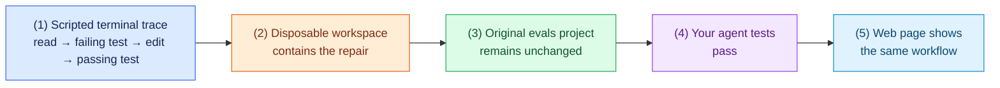

# Task 8: Prepare the final demonstration, 10 minutes

[Back to the activity overview](../README.md)

## What your demonstration should show

The goal is to show evidence that the repair agent follows a safe, repeatable
process. A successful live model run is optional. The required demonstration
uses the scripted provider, so every group can show the same repair workflow.
This task introduces no new code. Fix any earlier checkpoint that fails before
you begin the demonstration.

### Flow of this task



## Demonstration run sheet

Run these steps from the repository root, with your virtual environment active.
Explain what each result proves as you show it.

1. Run the required scripted repair:

   ```bash
   python main.py repair evals/arithmetic --provider scripted
   ```

   Point out the trace: the agent reads local code, reproduces a failing
   sandboxed test, edits the copied workspace, and verifies a passing test.

2. Show that the supplied project was not changed:

   ```bash
   git diff -- evals
   ```

   The expected output is empty. The changed file named in the repair result
   belongs to the disposable workspace, not to `evals/`.

3. Run your automated checks:

   ```bash
   python -m pytest -q
   ```

   Explain that these tests cover safe file paths and the repair loop. They use
   the scripted client and fake tools, so they do not execute a project on the
   host computer.

4. Start the web page:

   ```bash
   python main.py ui
   ```

   Open the displayed local address, choose `arithmetic`, and show the trace,
   changed files, and test output. Confirm that the page offers only the five
   supplied projects.

5. Explain the boundary in one sentence: the model proposes an action, while
   normal Python code checks it, controls the available tools, runs tests in
   Docker, and accepts or rejects the repair.

If you completed Task 7, you may additionally show a live Ollama trace. State
the model name and temperature, and report the actual result whether it passed
or failed. Do not replace the scripted demonstration with an unverified live
run.

### A term used in this task

**Evidence** is something another person can check: the visible trace, test
output, changed workspace files, and your automated test results. It is more
useful than saying that the agent “seems to work.”

## Submission checklist

- [ ] All source files in the target structure were created by your group.
- [ ] `python -m pytest -q` passes.
- [ ] Evaluation-project code runs only in Docker.
- [ ] The agent requires test reproduction before editing.
- [ ] The agent accepts only strict JSON actions and has a fixed stop budget.
- [ ] `python main.py repair evals/arithmetic --provider scripted` completes a repair.
- [ ] The original `evals/` projects are unchanged after every repair.
- [ ] `python main.py ui` exposes only the five supplied projects.
- [ ] Your Git history has a commit after each completed task.

## Where to go next

Return to the [activity overview](../README.md), complete the submission
checklist, and prepare your demonstration.
