# Task 9: Add bounded GitHub research (optional), 20 minutes

[Back to the activity overview](../README.md)

## Why this is optional

Complete this extension only after the scripted repair and Task 8 work. The
required agent has no Internet access. This task shows how a coding agent can
receive a small amount of external evidence without becoming a general web
browser.

The agent still has to inspect local code and reproduce the failure in Docker.
GitHub search can provide a few public examples after that evidence exists; it
never proves that an edit is correct. A later sandboxed test remains the only
repair verdict.

### Flow of this task

```mermaid
flowchart LR
    localRead["(1) Read local code"] --> reproduce["(2) Reproduce failure\nin Docker"]
    reproduce --> request["(3) Model requests\nsearch_github"]
    request --> gate["(4) Harness checks\nopt-in and evidence gate"]
    gate --> github["(5) GitHub code-search API\npublic results only"]
    github --> evidence["(6) Small citable\nevidence record"]
    evidence --> agent["(7) RepairAgent\ncontinues its normal loop"]

    classDef localBox fill:#f3e8ff,stroke:#9333ea,color:#581c87
    classDef sandboxBox fill:#dcfce7,stroke:#16a34a,color:#14532d
    classDef agentBox fill:#dbeafe,stroke:#2563eb,color:#172554
    classDef networkBox fill:#ffedd5,stroke:#ea580c,color:#7c2d12
    classDef evidenceBox fill:#e0f2fe,stroke:#0284c7,color:#0c4a6e

    class localRead localBox
    class reproduce sandboxBox
    class request,gate,agent agentBox
    class github networkBox
    class evidence evidenceBox
```



This extension must be off unless the user supplies `--research`. It may call
only GitHub's code-search API. It must not fetch arbitrary URLs, crawl sites,
use a shell command, access private repositories, or modify GitHub content.

## Create a short-lived GitHub token

The adapter needs a token for the GitHub API. Treat it like a password. Create
your own fine-grained token; never use a token shared in chat, source code, or
a Git commit.

1. Follow GitHub's [personal access token instructions](https://docs.github.com/en/authentication/keeping-your-account-and-data-secure/managing-your-personal-access-tokens).
2. In GitHub, open your profile menu, then **Settings**, **Developer settings**, **Personal access tokens**, and **Fine-grained tokens**.
3. Choose **Generate new token**, give it a short expiry, and use the minimum access possible. Do not grant write permissions or access to private repositories for this public-search exercise.
4. Copy the token once and set it only in the current terminal session.

**macOS or Linux**

```bash
export GITHUB_TOKEN="paste-your-token-here"
```

**Windows PowerShell**

```powershell
$env:GITHUB_TOKEN = "paste-your-token-here"
```

Check only whether the variable exists. Do not print the token:

```bash
python -c "import os; assert os.getenv('GITHUB_TOKEN'); print('GitHub token configured')"
```

The repository's `.gitignore` excludes `.env` files, but environment variables
are preferred for this short exercise. Remove the variable or close the
terminal when you finish.

## Prompt for your coding assistant

Copy this prompt into your coding assistant. It defines the complete scope of
this optional task.

```text
Implement the optional GitHub-research extension. Create
adapters/research/__init__.py and adapters/research/github_research.py. Modify
only core/ports.py, core/prompts.py, core/repair_agent.py, bootstrap.py,
main.py, and the focused tests needed for this extension. Keep the required
repair path unchanged when --research is absent.

In core/ports.py, define a small optional ResearchPort with
search_github(query) -> dict. Do not add research to the sandbox file-tools
contract. In adapters/research/github_research.py, implement that port with
the Python standard library and only the GET GitHub code-search endpoint. Read
GITHUB_TOKEN from the environment at composition time, never from source.
Reject an empty, multi-line, or over-180-character query. Allow at most three
requests and three results in one repair. Return only a small JSON-compatible
evidence record: query, retrieval time, and sources containing repository,
path, GitHub URL, and a snippet no longer than 500 characters. Never return a
token, request headers, full remote files, or arbitrary fetched pages. Discard
any result that GitHub marks as private, even if a misconfigured token can see
it.

When --research is supplied, bootstrap.py may construct the adapter and inject
it into RepairAgent. Without that flag, do not construct it. Add a strict
search_github action shape to the parser only when research is enabled:
{"tool":"search_github","query":"Python median even length","summary":"Find a public reference"}
Do not weaken the existing parser or add a shell/browser tool. The system
prompt must call research optional evidence, not an authority.

Enforce the policy in RepairAgent, not only in the prompt: reject a search
until this repair has both a successful local read_file observation and a
failing sandboxed run_tests observation. Show a visible policy-error result
when the request is too early. The default Gradio page must not enable
research. Keep the existing rule that only a later passing sandboxed test can
finish a repair.

Write tests using a fake research port or mocked HTTP response. Prove that
disabled research and early research make no API call, that the query and
request budgets are enforced, and that an allowed result preserves its GitHub
source URL in the visible observation. Tests must never contact GitHub. Add
concise docstrings. Do not change evals/ or execute evaluation-project code
with host Python.
```

### A term used in the prompt

**Provenance** means where a piece of evidence came from. Here, every search
result keeps its GitHub repository, path, and URL. That lets a person check an
external suggestion instead of treating it as a fact.

## Checkpoint

```bash
python -m pytest -q tests/test_github_research.py tests/test_agent.py
python -m pytest -q
python main.py repair evals/arithmetic --provider scripted
```

Expected outcome: all tests pass without contacting GitHub, and the ordinary
scripted repair still works with research disabled. The GitHub token is needed
only for a live run with `--research`.

## Optional live demonstration

If Task 7 also works, you may enable the extension in a real local-model run:

```bash
python main.py repair evals/arithmetic --provider ollama --research --temperature 0.0
```

The model may decide that local evidence is sufficient and never request
GitHub search. If it does search, show the visible query and cited source URLs.
Report the actual final test result either way.

## Where to go next

Open [Task 10: Record a trajectory with Langfuse Cloud](10-langfuse-observability.md), or return to the [activity overview](../README.md).
