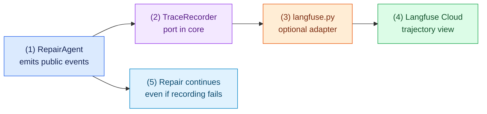

# Task 10: Record a trajectory with Langfuse Cloud (optional), 20 minutes

[Back to the activity overview](../README.md)

## Why this is optional

Complete this extension only after the scripted repair and Task 8 work.
Observability means recording what an agent did so a person can review its
trajectory: which action it requested, which tool ran, and why it stopped.
It helps analyze failures without putting a logging service inside the repair
rules.

This task uses Langfuse Cloud only. It is off by default and does not change
the agent's tools, Docker sandbox, prompts, or repair verdict.

### Flow of this task



The important separation is simple: `core/` emits generic events through the
small recorder interface from Task 1. `adapters/observability/langfuse.py`
knows how to send them to Langfuse Cloud. The repair loop never imports the
Langfuse SDK.

## Create a Langfuse Cloud project

Use your own Langfuse Cloud account and project. Do not use self-hosted
Langfuse for this activity.

1. Open the [Langfuse Cloud tracing guide](https://langfuse.com/docs/observability/get-started) and create an account or sign in.
2. Create a project, then open its **Settings** and **API Keys** page.
3. Create a key pair and copy the public and secret keys. The secret key is a credential: do not commit, print, or paste it into a prompt.
4. Set the keys only in the terminal where you will run the demonstration. Use the Langfuse Cloud region shown for your project. The URL below is the EU Cloud default.

**macOS or Linux**

```bash
export LANGFUSE_PUBLIC_KEY="pk-lf-..."
export LANGFUSE_SECRET_KEY="sk-lf-..."
export LANGFUSE_BASE_URL="https://cloud.langfuse.com"
```

**Windows PowerShell**

```powershell
$env:LANGFUSE_PUBLIC_KEY = "pk-lf-..."
$env:LANGFUSE_SECRET_KEY = "sk-lf-..."
$env:LANGFUSE_BASE_URL = "https://cloud.langfuse.com"
```

The lab fixtures are public teaching examples, but do not enable this adapter
for a project whose model messages, file names, or test output are private.

## Prompt for your coding assistant

Copy this prompt into your coding assistant. It defines the complete scope of
this optional task.

```text
Implement the optional Langfuse Cloud observability extension. Create
adapters/observability/__init__.py and adapters/observability/langfuse.py.
Modify only core/repair_agent.py, bootstrap.py, main.py, and focused tests.
Reuse the TraceRecorder Protocol from core/ports.py. Do not import Langfuse in
core/.

Make RepairAgent accept an optional recorder. Emit repair_started,
model_response, tool_result, and repair_finished through recorder.record when
one is present. Keep the visible terminal trace unchanged. Recorder failures
must be caught and logged by the adapter; a failed recording must never change
the repair result or stop a repair.

Implement LangfuseTrajectoryRecorder in adapters/observability/langfuse.py
using the installed langfuse Python package and Langfuse Cloud credentials from
LANGFUSE_PUBLIC_KEY, LANGFUSE_SECRET_KEY, and LANGFUSE_BASE_URL. Start one root
agent observation for a repair, add closed child observations for model and
tool events, then close and flush the root when the repair finishes. Use the
current installed SDK's documented client API. Do not add another package or a
local Langfuse deployment.

Send a deliberately small public payload: case name, step number, requested
tool name, public summary, pass/fail status, return code, changed relative
file names, and final outcome. Do not send credentials, environment variables,
raw system or user prompts, raw model text, source-file content, replacement
file content, or full test output. Do not add a shell tool or change Docker
execution.

Add --observe to the terminal repair command. It must be off by default. When
--observe is requested, validate that the three Langfuse environment variables
exist before starting a repair and show a clear error if one is missing. Do not
change the default Gradio page. Write tests with a fake Langfuse client that
prove event order, flush on repair_finished, and best-effort failure handling.
No test may contact Langfuse Cloud. Add concise docstrings and do not change
evals/.
```

### A term used in the prompt

An **observer** receives information about an event but does not decide what
the program does next. Here, the observer can record a repair trajectory, but
only `RepairAgent` decides whether an action is allowed and whether tests pass.

## Checkpoint

```bash
python -m pytest -q tests/test_langfuse_observability.py tests/test_agent.py
python -m pytest -q
python main.py repair evals/arithmetic --provider scripted
```

Expected outcome: all tests pass without contacting Langfuse, and the normal
scripted repair still works with observation disabled.

## Optional Cloud demonstration

With the three environment variables configured, run:

```bash
python main.py repair evals/arithmetic --provider scripted --observe
```

After the command finishes, open your Langfuse Cloud project and inspect one
agent trajectory. It should show the public repair events in order. If the
keys or Cloud connection are unavailable, report that observation was not
enabled and show the normal scripted repair instead.

## Where to go next

Return to the [activity overview](../README.md). These optional extensions do
not replace the required Task 8 demonstration.
